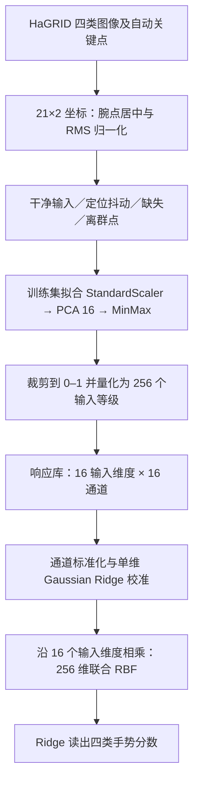

# FYP_Gaussian

**HaGRID 手势识别：器件响应约束下的联合 Gaussian 编码、目标宽度优化与鲁棒性研究。**

本仓库整理 FYP_2026 的手势识别主线，包含实验代码、汇总结果、图表及阶段汇报。视频动作识别（HMDB51 等）属于另一个项目，不在本仓库范围内。

## 阅读入口

- [研究设计、数学模型与复现流程](docs/研究设计与复现.md)
- [数据来源、划分及发布范围](docs/数据与发布范围.md)
- [最新实验结果与下一步](docs/最新实验汇总.md)
- [五页 XJTLU 汇报 PPT](reports/weekly/HaGRID_XJTLU_weekly.pptx) · [PDF](reports/weekly/HaGRID_XJTLU_weekly.pdf) · [逐页讲稿](reports/weekly/speaker_notes.md)
- [结果文件与图表索引](results/README.md)

## 为什么选择 HaGRID？

[HaGRID 官方项目](https://github.com/hukenovs/hagrid)面向静态手势，提供类别、手部框、用户身份与划分信息，适合建立可审计的手势识别实验。本研究使用 fist、like、peace、ok 四类真实图像对应的自动关键点，将同一批样本转为低维坐标输入，便于与器件输入接口衔接。

选择它是因为任务明确、可以控制变量、可以研究定位抖动／缺失／离群点对识别的影响，并非为了保证 Gaussian 胜过其他分类方法。早期干净特征上的线性结果很好，说明该子任务本身较容易；这些历史实验保留在本地，当前主线转向器件响应约束下的鲁棒性。

## 研究核心

1. 把真实手势关键点映射为器件可接收的 16 维、256 等级输入。
2. 用响应库构造 16 个输入维度 × 16 路响应，再校准、重建 256 维联合 Gaussian 特征。
3. 比较共享单宽度、验证集选择的定向多宽度及随机多宽度。
4. 分别研究关键点定位抖动、缺失、离群点；另用响应库的 Cycle 波动研究硬件响应变化。

**当前属于响应库驱动的软件实验，不是新采集的端到端硬件验证。** 宽度优化改变的是校准目标 Gaussian 的宽度，不等于已经物理调节了器件的响应宽度。最终仍使用 Ridge 读出类别分数。

## 软件工作流程



这里的 **256 输入等级、256 个原始响应、256 个联合特征是三个不同概念**。PCA 的 16 维不是直接选取 8 个手部点；原始响应阵列也不能仅靠 reshape 就变成联合 RBF 特征。

## 对应数据与评估

| 数据 | 用途 | 当前规模 |
|---|---|---|
| HaGRID 四类开发子集 | 真实手势与自动关键点 | 800 个候选，786 个保留样本／用户 |
| 三折嵌套用户划分 | 训练、验证选参、外层评估 | 395/133/258；391/131/264；392/130/264 |
| 关键点扰动缓存 | 同样本、同种子的配对鲁棒性评估 | 10 个随机种子，三种扰动 |
| 器件响应库 | 输入等级到通道响应的查询 | 256 等级 × 400 Cycle × 16 通道 |

保留样本：fist 192、like 196、peace 198、ok 200。当前使用复用的开发数据外层评估，不应表述为全新官方测试集确认实验。

## 当前主要结果

各扰动全部规定强度、10 个扰动种子的平均 Macro-F1；详见结果文件。

| 扰动 | 调优单宽度 | 定向多宽度 | 随机多宽度均值 |
|---|---:|---:|---:|
| 定位抖动 | 0.832621 | 0.829919 | 0.804737 |
| 关键点缺失 | 0.915839 | 0.919835 | 0.913881 |
| 离群点 | 0.821567 | 0.827971 | 0.776947 |

多宽度在缺失和离群点上有小幅改善，在定位抖动上略降，不支持“总能提高”。定向搜索获得的验证反馈多于 10 个随机配置，不能声称搜索预算公平。


加入 Cycle 波动后，跨强度平均 Macro-F1 分别为：定位抖动 0.826564 / 0.824946，缺失 0.898571 / 0.903466，离群点 0.813129 / 0.819744（单宽度 / 定向多宽度）。下一步优先研究 Cycle 感知校准，尤其是重度缺失的退化。

## 代码与运行

| 文件 | 功能 |
|---|---|
| `hagrid_hardware_clean.py` | 输入压缩、量化、干净输入校准与评估 |
| `hagrid_hardware_perturbations.py` | 冻结模型的关键点扰动评估 |
| `hagrid_hardware_width_scan.py` | 验证集选择共享目标宽度 |
| `hagrid_hardware_multiwidth.py` | 定向搜索及随机多宽度对照 |
| `hagrid_hardware_cycle.py` | 冻结模型、抽取 Cycle 响应进行评估 |
| `check_reproduction_inputs.py` | 检查主要外部依赖文件 |

`landmark_*.py` 与 `multiwidth_experiment.py` 保留为以上代码依赖的关键点处理、扰动和指标工具；它们的历史入口不代表当前推荐运行路径。

```bash
python3.10 -m venv .venv
source .venv/bin/activate
pip install -r requirements-hagrid.txt
export RBF_HARDWARE_ROOT=/path/to/rbf_hardware
python check_reproduction_inputs.py --stage clean
```

**仅克隆仓库还不能完整重跑**：原始 HaGRID 数据、精确划分／关键点缓存、外部 `rbf_hardware` 源码及响应库需要按授权另行取得。完整文件要求和分阶段命令见[复现文档](docs/研究设计与复现.md)。仓库不会下载完整数据集或以模拟数据替代缺失实测响应。

## 发布边界

本次发布代码、聚合统计、图表和汇报。原始图像、用户级清单、特征缓存、模型、响应库和旧数据集不提交；本地历史文件不删除。数据与模板权利归各自权利人；本仓库没有替第三方数据授予再分发许可。
