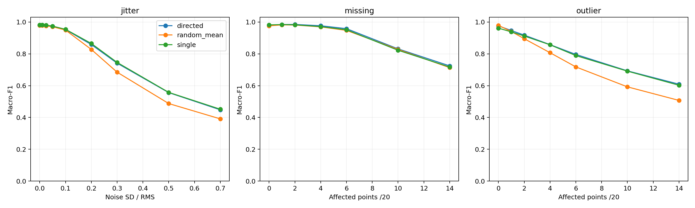
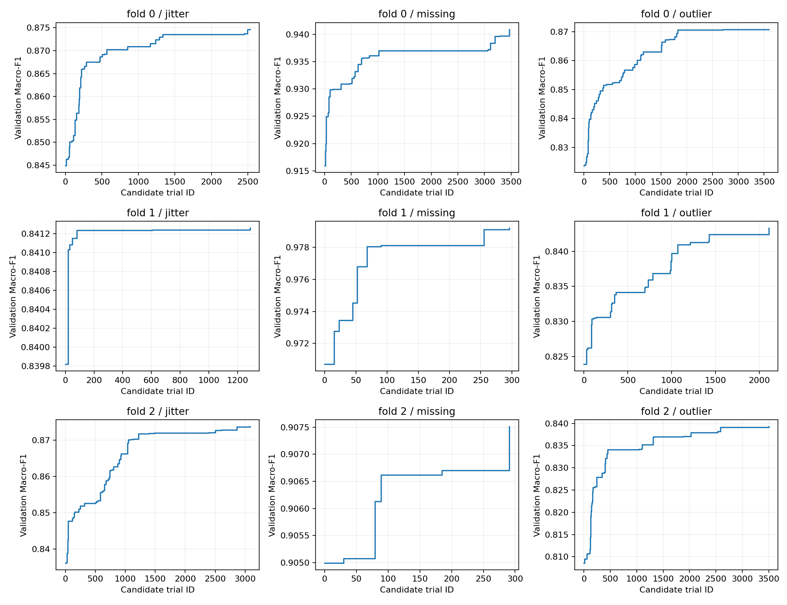
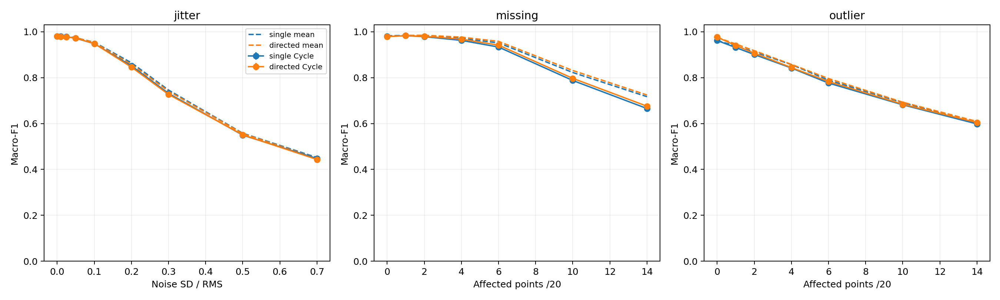

# 最新实验汇总

当前主线为 HaGRID 关键点 → 16 维输入 → 响应库 → 单维校准 → 256 维联合 Gaussian → Ridge 读出。以下均为 Macro-F1，不是 Accuracy。

## 多宽度对照

| 扰动类型 | 调优单宽度 | 定向多宽度 | 随机多宽度均值 |
|---|---:|---:|---:|
| 定位抖动 | 0.832621 | 0.829919 | 0.804737 |
| 关键点缺失 | 0.915839 | 0.919835 | 0.913881 |
| 离群点 | 0.821567 | 0.827971 | 0.776947 |

跨规定强度及 10 个扰动种子汇总。缺失提升 0.40 个百分点、离群点提升 0.64 个百分点，抖动下降 0.27 个百分点。定向搜索共评估 32,256 个候选配置、290,304 次 Ridge 拟合；这不是新增独立样本数。10 个随机配置与定向搜索的预算不同。

## Cycle 波动对照

冻结已选择模型，在 10 个关键点种子 × 10 个 Cycle 种子下复用配对扰动，不根据外层分数重新选择配置。

| 条件 | 均值响应：单宽度 | Cycle：单宽度 | 均值响应：多宽度 | Cycle：多宽度 |
|---|---:|---:|---:|---:|
| 定位抖动 20% | 0.864991 | 0.851355 | 0.858368 | 0.846045 |
| 定位抖动 70% | 0.451721 | 0.447391 | 0.447853 | 0.443149 |
| 缺失 14 个非腕点 | 0.716949 | 0.665382 | 0.724299 | 0.675451 |
| 离群 14 个非腕点 | 0.602326 | 0.598272 | 0.609001 | 0.604282 |

共计算 3,615,600 次预测，仍来自同一批 786 个样本，不能当作数百万独立测试样本。重度缺失在 Cycle 波动下退化较突出，其他场景的变化相对较小。

## 已完成验证与限制

已保存单宽度一致性、混合宽度重建、模型重载、配对 Cycle 和数值有限性检查文件。结果反映软件中的响应库扰动，不证明实际硬件延迟、功耗或物理宽度调节收益。随机种子标准差不是总体测试不确定性；重复使用开发数据意味着结论仍属探索性。

## 下一步（尚未完成）

优先对重度缺失进行 Cycle 感知校准训练；事先留出 Cycle，冻结输入、中心、宽度候选池和外层数据，比较均值校准与新校准的收益及代价。继续保留不提升的场景，避免根据已有外层结果反复挑选最佳设定。再考虑新用户／新采集数据确认，以及真实硬件部署。
